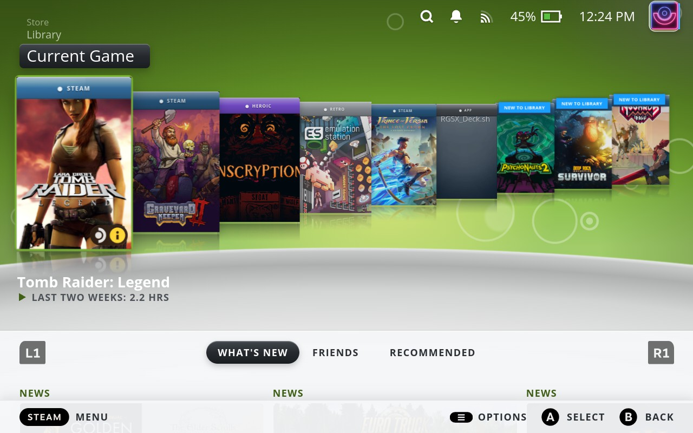
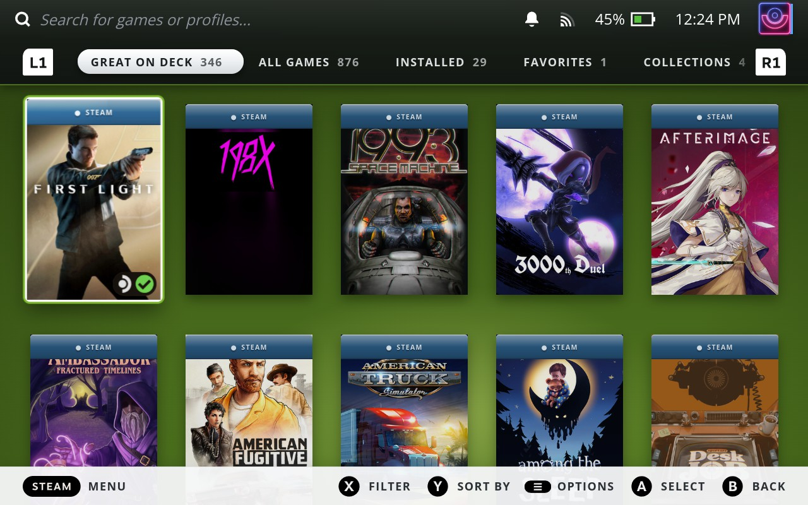
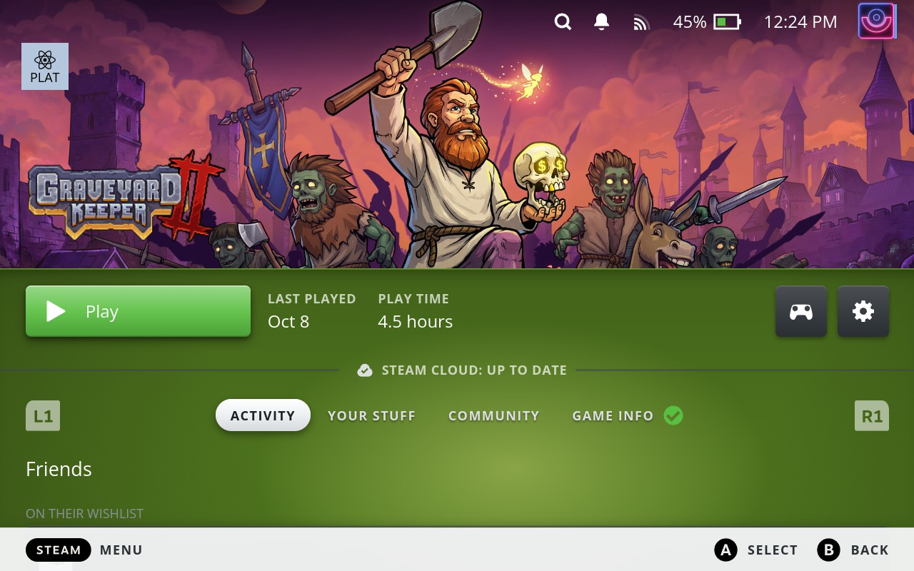
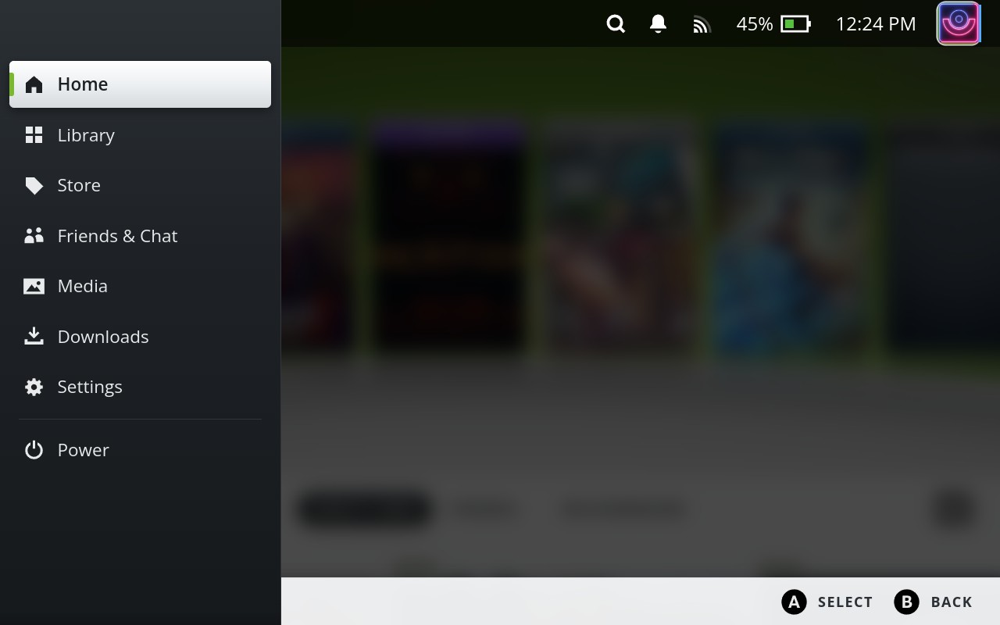
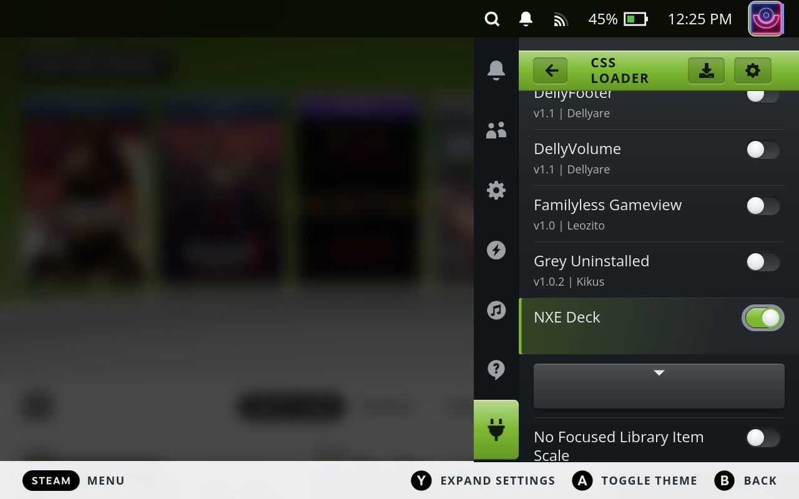

# NXE Deck

A [CSS Loader](https://github.com/DeckThemes/SDH-CssLoader) theme for the Steam Deck, inspired by the Xbox 360 "New Xbox Experience" of 2008. It gives you a lime sky over a silver floor with reflections, a game blade that recedes into the distance, a Guide-style Steam menu and a mini-blade Quick Access menu. The same look carries through the Library, game pages and the rest of the gamepad UI.



| Library | Game page |
|---|---|
|  |  |
| **Steam menu** | **Quick Access** |
|  |  |

## Features

- **Home.** A lime sky with soft bokeh over a silver floor, with reflections under every capsule.
  - The focused game is always left-most. The games after it shrink and rise behind it like the NXE blades.
  - The slide and the depth move in one motion with Steam's own scroll.
- **Steam menu** as the Guide: a dark panel and a silver focus bar with an accent tab.
- **Quick Access** as a mini blade:
  - a glossy accent header;
  - sliders with silver sphere thumbs and toggles that match;
  - glossy keys for Decky plugin buttons.
- **Library:**
  - a clean dusk sky and a graphite tab strip;
  - case bands on every cover, which can name each game's source: STEAM, HEROIC, RETRO or APP;
  - Collections tiles.
- **Game pages:**
  - the sky under the hero art, a glossy Play button and tabs;
  - Community cards;
  - controller settings and View Layout;
  - an Achievements list that folds the summary away as you scroll.
- **Everywhere else:**
  - Downloads, Settings (and game Properties), Media, and Friends & Chat;
  - the in-game panel;
  - context menus and confirmation dialogs;
  - Steam's focus ring.
- **Make it yours:**
  - eight accent presets or any custom colour;
  - three backgrounds (NXE green, Silver studio, or your own wallpaper);
  - an adjustable horizon;
  - a toggle for every part of the theme.

## Requirements

- A Steam Deck in Game Mode.
- [Decky Loader](https://decky.xyz) with the **CSS Loader** plugin, installed from Decky's store.

## Install

> **Coming soon to the DeckThemes store.** NXE Deck is being prepared for CSS Loader's built-in theme store, so you'll be able to install and update it from your Deck. Until then, install it from GitHub as below.

1. Download `NXE-Deck-<version>.zip` from the [latest release](https://github.com/Zgn-Bhr/NXE-Deck/releases/latest).
2. In Desktop Mode, extract it into `/home/deck/homebrew/themes/`. You should end up with `/home/deck/homebrew/themes/NXE Deck/theme.json`.
   The folder name must be exactly `NXE Deck`, because the fonts and the default wallpaper are loaded from that path.
3. Go back to Game Mode. In CSS Loader, refresh the theme list and turn **NXE Deck** on. Turn off other system-wide themes so they don't fight over the same elements.

**Updating:** move the old `NXE Deck` folder out of `themes` before you extract the new one. Otherwise the file manager may create `NXE Deck (1)`, and that copy won't load. Renaming the old folder isn't enough, because CSS Loader loads every folder in `themes`.

## Options

Open them in CSS Loader by selecting NXE Deck.

| Option | Default | What it does |
|---|---|---|
| Accent | NXE Green | Presets (NXE Green, Blue, Orange, Purple, Red, Pink, Teal, Silver) or Custom, which adds a colour picker. The sky, bands, badges and focus rings all follow it. |
| Background | NXE green | NXE green (a lime sky over a silver floor), Silver studio, or Custom image. The Library and other pages use a darker version of each. |
| Wallpaper | bundled sample | Used when Background is set to Custom image. Copy a JPG or PNG into `/home/deck/homebrew/themes/`, then pick it here. |
| Floor line | 57% | Height of the horizon. Set it just under the capsules. |
| Library skin | on | The Home look on the Library. |
| Game page skin | on | The same look on game pages, controller settings and View Layout. |
| Other pages | on | Downloads, Settings (and game Properties) and Media. |
| NXE scrolling | on | The focused game is always left-most, and earlier games slide off to the left. |
| Carousel depth | on | Capsules after the focused one shrink and rise. |
| Ghost channels | on | "Store / Library" labels above the Recent Games pill. |
| Case bands | By source | **By source:** a coloured band naming each cover's source (see below). **Steam Deck:** an accent band reading STEAM DECK. **Off:** no bands. |
| Light footer | on | A light button-legend bar on the themed pages. |
| Debug outlines | off | Outlines every element the theme targets. Use it to report what doesn't look right. |

Menus, dialogs, Quick Access and Friends & Chat are always themed while NXE Deck is on.

## Case bands by source

| Band | Colour | Used for |
|---|---|---|
| STEAM | Steam blue | Steam games, including ones with custom (SteamGridDB) artwork |
| HEROIC | violet | Games added from the Heroic Games Launcher |
| RETRO | grey | Emulators, EmuDeck / ES-DE / RetroArch, and emulated games |
| APP | graphite | Any other non-Steam shortcut |

A CSS theme can only see a cover's image address, not where the game came from. Out of the box, every cover reads STEAM, and non-Steam shortcuts without artwork read APP.

To label your own Heroic, emulator and app shortcuts, run the small script in `tools/gen_sources.py`. It reads Steam's list of your non-Steam shortcuts (`shortcuts.vdf`) and sorts each one by its launch command. It then writes a CSS file containing only the shortcuts' numeric IDs: no game names or paths.

On the Deck, in Desktop Mode, open Konsole and run these two commands:

```bash
curl -LO https://raw.githubusercontent.com/Zgn-Bhr/NXE-Deck/main/tools/gen_sources.py
```

```bash
python3 gen_sources.py --out ~/homebrew/themes/"NXE Deck"/options/sources.css
```

Then, in CSS Loader, turn NXE Deck off and on again (or refresh the theme list).

Run the second command again whenever you add non-Steam games, and after each theme update, because an update brings back the neutral file.

From another computer with SSH access to the Deck, you can use this instead:

```bash
DECK=deck@<deck-ip> python3 tools/gen_sources.py --out sources.css
```

Then copy `sources.css` to the same place on the Deck.

## Troubleshooting

- **Something looks broken:** turn NXE Deck off in CSS Loader. Everything returns to stock immediately.
- **Quick Access is unusable:** in Desktop Mode, move `/home/deck/homebrew/themes/NXE Deck` out of `themes`, then go back to Game Mode.
- **The theme doesn't load, or CSS Loader says "Image Picker specified image does not exist":** the folder isn't named exactly `NXE Deck`, or there is a second copy in `themes`.
- **After a Steam update a part looks stock:** Steam renames its internal class names from time to time. CSS Loader's translation table usually catches up within days. If it doesn't, please [open an issue](https://github.com/Zgn-Bhr/NXE-Deck/issues) with a screenshot (**Steam + R1**). Turning on **Debug outlines** first helps show which element was missed.
- **Home tabs (What's New / Friends / Recommended) don't switch:** check with the theme off. On some setups this is Steam's own behaviour, not the theme.

## Development

The theme is plain CSS in [`NXE Deck/`](NXE%20Deck/). It uses Steam's readable class names (`module_ClassName`), which CSS Loader translates to the current hashed names at load time.

| Path | What it is |
|---|---|
| `NXE Deck/` | The theme as CSS Loader loads it: `theme.json`, one stylesheet per area, and `options/` for the toggles |
| `tools/check_theme.py` | Static checks: the manifest, and every class name against CSS Loader's translation table (and the local Steam client, if installed) |
| `tools/gen_depth.py`, `tools/gen_scroll.py` | Generate `options/depth.css` and `options/scroll.css` (the scroll-driven carousel) |
| `tools/gen_sources.py` | Case bands "By source" (see above) |
| `tools/deploy.sh` | `DECK=deck@<deck-ip> tools/deploy.sh`: checks, then copies the theme to a Deck over SSH |
| `tools/package.sh` | Builds `dist/NXE-Deck-<version>.zip` |
| `tools/deckdom.mjs`, `tools/cdp.mjs`, `tools/probe.js` | Read-only inspection of the live Steam UI over the CEF debugger |
| `docs/` | Selector map, hardware test checklist, build notes and reference renders |

## Support

NXE Deck is free, and every option is included. There are no paid features, supporter editions or early access, and there never will be.

If it brightened up your Deck and you'd like to say thanks, you can [buy me a coffee](https://buymeacoffee.com/zgnbhr). It's a tip, not a purchase: completely optional, and it gets you nothing extra. Starring the repo, reporting bugs and sharing it with friends help just as much.

## Credits and licence

- Theme code: [MIT](LICENSE).
- [Open Sans](https://github.com/googlefonts/opensans) is bundled under the SIL Open Font License 1.1 (`NXE Deck/fonts/OFL.txt`).
- All artwork is drawn in CSS or rendered from it. The theme bundles no Microsoft or Valve assets.

NXE Deck is a fan-made tribute. It is not affiliated with, or endorsed by, Microsoft or Valve. Xbox, Xbox 360 and New Xbox Experience are trademarks of Microsoft. Steam and Steam Deck are trademarks of Valve.
